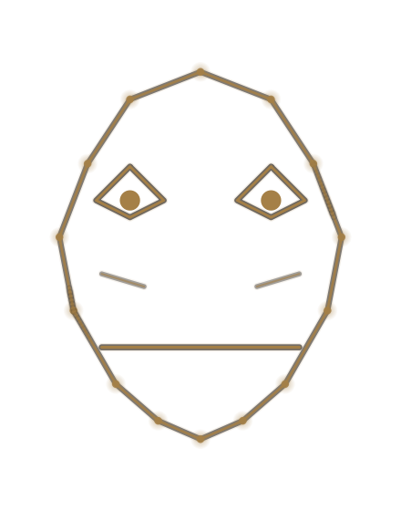
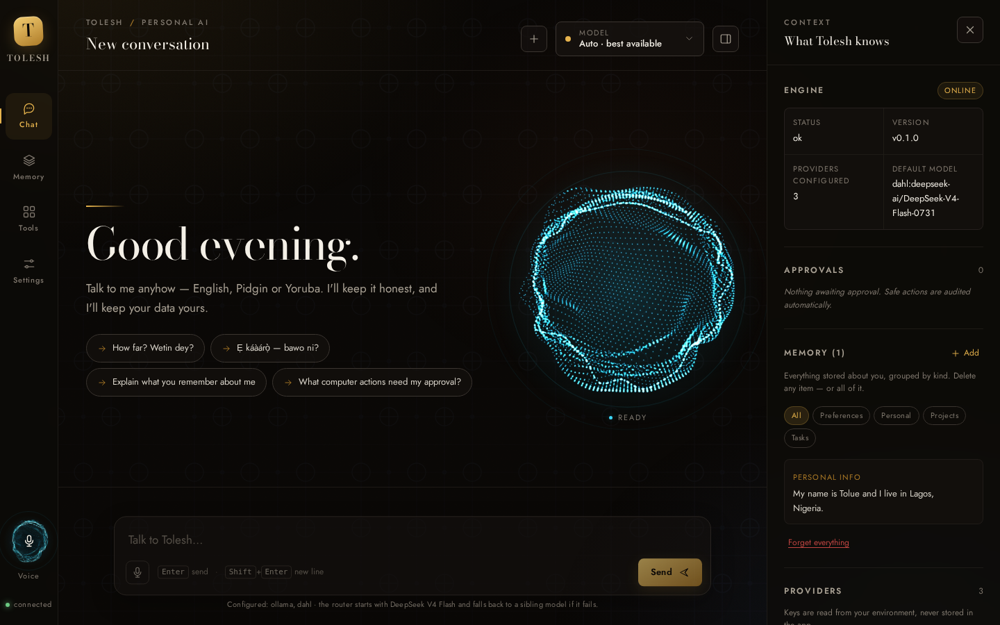
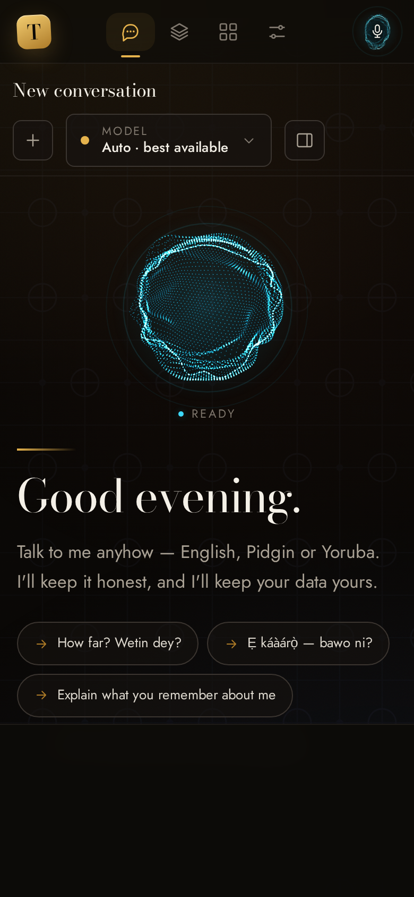

# Tolesh

> A private, local-first AI assistant with a provider-independent model router,
> transparent personal memory and permission-gated computer control.
> Male-presenting, warm, intelligent and culturally Nigerian — understands
> Nigerian English, Nigerian Pidgin and Yoruba, and is always honest that his
> emotions are simulated.

**Tolesh is not a greenfield rewrite.** It is a transformation of existing
JARVIS source code, as required. The [`isair/jarvis`](https://github.com/isair/jarvis)
tree was selected as the strongest foundation, copied verbatim into this
repository, rebranded across 479 files, then extended with new AI routing,
memory, permission, persona, server and interface modules. All three candidate
repositories were cloned and inspected first; see [ARCHITECTURE.md](ARCHITECTURE.md).

---

<p align="center">
  
</p>

<p align="center"><sub>A voice, a face, and a place in the conversation.</sub></p>

The face above is Tolesh's own brand asset. It is derived from the inherited
upstream illustration (`docs/img/upstream-face.png`, kept for attribution) and
re-graded into the Lagos Nocturne palette — warm near-black ink, burnished
brass and a trace of adire indigo — described in [DESIGN.md](DESIGN.md).

## Status at a glance

| Area | State | Notes |
| --- | --- | --- |
| Source inspection | Done | 3 repos cloned to `_sources/`, compared, licence-checked |
| Foundation | Done | `isair/jarvis` → `/workspace/tolesh` (independent git working copy) |
| Rebrand | Done | 479 files; JARVIS naming, UI strings, website, installer scripts |
| New Python modules | Done | `ai/`, `conversation/`, `memory_ext/`, `permissions/`, `persona/`, `server/`, `tools_ext/` |
| Web interface | Done | `web/` — real design system, components, GSAP motion, voice surface |
| Browser verification | Done | Chromium/Playwright: desktop, mobile, streaming chat, dialogs, zero JS errors |
| Skill installation | Done | 28 skills installed to the agent; see [SKILLS.md](SKILLS.md) |
| Documentation | Done | 8 mandatory documents + this README |
| MCP integration | Done | stdio + streamable HTTP, tools/resources/prompts, per-tool permissions, approvals — [docs/MCP.md](docs/MCP.md) |
| External connections | Done | GitHub, Google Drive, Gmail, Google Calendar, Notion, Slack; OAuth + PKCE, encrypted vault |
| Multi-step agents | Done | Bounded loop, 14 tools, exact-call approvals, cancellation, persisted history |
| Data analysis | Done | CSV/XLSX profiling, five chart types, HTML reports, downloadable artifacts |
| Images and voice | Done | Vision input, configurable image generation, STT/TTS with explicit capability reporting |
| Background tasks | Done | Once or interval, pause/cancel, progress, notifications, persistent state |
| Settings and privacy | Done | Typed settings, audit log, zip export, exact-phrase deletion, opt-in sharing |
| Parity checklist | Done | [docs/CHATGPT-PARITY-CHECKLIST.md](docs/CHATGPT-PARITY-CHECKLIST.md) — every row marked honestly |
| Backend test suite | See [TESTING.md](TESTING.md) | Exact results recorded there, not glossed over |
| Desktop Qt shell | **Integrated** | `desktop_app` owns the FastAPI engine in-process; AI window loads `web/` in QtWebEngine |
| Desktop launch (Linux) | **Verified** | Xvfb + xcb: engine online, UI rendered, data survived exit; screenshot in `docs/img/` |
| Web / Android clients | Architecture only | Shared `/api` contract is ready; no separate clients built yet |

---

## Quick start

Requirements: Python 3.11+, Node 22+ (only for the skills CLI), Chromium for
browser checks. On Linux, Qt also needs `libxcb-cursor0` and
`libxcb-icccm4`/`libxcb-keysyms1` — the launcher checks and tells you.

### Desktop application (the product)

```bash
cd /workspace/tolesh
./scripts/run_linux.sh            # Windows: scripts\run_desktop_app.bat
```

That is the whole procedure. The script creates `.venv`, installs
`requirements.txt`, checks the Qt runtime, and launches `python -m desktop_app`.
**The AI engine starts inside the application** — one process, one window, one
database. There is no uvicorn command to run and no second service to manage.

`./scripts/run_linux.sh --check` verifies the environment without starting
anything; `--daemon` runs the inherited headless voice daemon instead.

### Headless / browser client (for development and the future web build)

```bash
# Same API, started by hand. Not required for the desktop app.
PYTHONPATH=src TOLESH_WEB_DIR=$PWD/web \
  python3.11 -m uvicorn tolesh.server.app:app --host 127.0.0.1 --port 8787
# then open http://127.0.0.1:8787/
```

Both paths share one database: `$TOLESH_DATA_DIR/tolesh.db`
(default `~/.local/share/tolesh/tolesh.db`, `%LOCALAPPDATA%`-equivalent via
`XDG_DATA_HOME`). Conversations, memory, permissions and usage all live there,
so they survive restarts and are identical whether the app or the standalone
server wrote them.

### A public URL (Cloudflare quick tunnel)

```bash
./scripts/serve_public.sh          # prints http://127.0.0.1:8787/?token=… and https://<name>.trycloudflare.com/?token=…
./scripts/serve_public.sh --no-tunnel
```

The script starts the server, generates a bearer token once into `.run/token`,
opens a `cloudflared` tunnel, and prints both links. **Every `/api` route needs
that token** — the frontend reads it from `?token=` once, keeps it in
`localStorage` and strips it from the address bar, so a link without the token
loads the shell and then gets `401` on every request. `/api/health`, the OAuth
callback and `/share/…` links stay public by design.

What this is and is not: a quick tunnel has no SLA, gets a new hostname on every
restart, and terminates TLS in front of a plain-HTTP local server. It is fine
for showing someone the product for an hour. For anything that must stay up,
use a named tunnel on your own domain and put the token in front of it.

The app runs with **zero API keys**. In that state the router uses the
deterministic `offline:tolesh-offline` engine, which is a rule-based,
culturally-aware conversation surface — it is explicitly **not a language
model** and never pretends to be one. Add a key to enable a real provider.

### Providers this build routes to

Every provider is an OpenAI-compatible registry entry, so adding one is a
catalogue entry plus a key — not new plumbing. The endpoints below were read
from each provider's own documentation and checked with a real request:

| Provider | Base URL | Key variable | Models declared |
|---|---|---|---|
| Token Harbor | `https://tokenharbor.ai/v1` | `TOLESH_TOKENHARBOR_API_KEY` (`thk_live_…`) | `deepseek-v4.1-flash`, `deepseek-v4.1-flash:free`, `mimo-v2.6-flash`, `mimo-v2.6-flash:free`, `glm-5.3-flash` |
| DeepSeek | `https://api.deepseek.com/v1` | `TOLESH_DEEPSEEK_API_KEY` | `deepseek-chat`, `deepseek-reasoner` |
| Dahl | `https://inference.dahl.global/v1` | `TOLESH_DAHL_API_KEY` | `deepseek-ai/DeepSeek-V4-Flash-0731`, `MiniMaxAI/MiniMax-M2.7`, `zai-org/GLM-5.3-Flash` |
| Xiaomi MiMo | `https://api.xiaomimimo.com/v1` | `TOLESH_MIMO_API_KEY` (`sk-…`) | `mimo-v2.6-flash`, `mimo-v2.6-pro` |
| MiniMax | `https://api.minimax.io/v1` | `TOLESH_MINIMAX_API_KEY` | `MiniMax-M3.1-Flash`, `MiniMax-M3` |

Two honest notes about the catalogue. `:free` is Token Harbor's own suffix for
free-tier admission of the same model, not a label invented here — a key with no
plan answers `402 balance_zero` on the paid id while the `:free` id still works.
And MiniMax's own platform no longer serves the `MiniMax-M2.7` id that Dahl
does; M2.7 is declared against Dahl, and the platform entry carries M3.1-Flash
and M3 instead of a model id that would never answer.

### The fallback chain, and how to change it

The conversation chain is DeepSeek V4.1 Flash (Token Harbor) → DeepSeek's own
API → GLM-5.3 Flash → MiMo V2.6 Flash → MiniMax M2.7, then whatever else is
configured, ending with the offline engine. Providers with no key are dropped
from the chain, so a declared-but-unkeyed step costs nothing.

**Settings → Fallback order** edits this without a restart: move a model up or
down, or switch it off. Switched-off models stay visible (parked at the bottom,
marked `off`) so they can be switched back on. *Reset* restores the built-in
order. The choice is written to the per-user config, and `/api/health` reports
the resulting chain as `fallback_order` so the line under the composer states
what will actually run.

### Connecting Dahl (the provider this build is wired against)
Dahl's gateway is OpenAI-compatible, so it is a registry entry, not new code:

```bash
export TOLESH_DAHL_API_KEY=dahl_...
export TOLESH_DAHL_BASE_URL=https://inference.dahl.global/v1   # already the default
```

Or use the app: **Settings → Dahl → paste the key → Save**, then
**Load model list from endpoint**. That button performs one real
`GET /v1/models` with the stored key and lists exactly what the gateway serves;
ticked ids become the picker's catalogue and are written to
`~/.config/tolesh/providers.json` (mode `0600`, outside the repository).
The key is never echoed back — every endpoint returns `"api_key": "***"`.

The gateway's free tier is queued behind paid traffic, so a busy model answers
`429 {"error":{"code":"model_concurrency", ...}}` and names the models that are
free at that moment. Tolesh handles this honestly rather than hiding it:

* the failing model is named in the stream (`provider_error` with `status: 429`,
  the gateway's `code` and its own `Retry-After`),
* the router then tries the other Dahl models before any other vendor, in the
  order **DeepSeek V4 Flash → GLM-5.3 Flash → MiniMax M2.7**,
* a model that reports `model_concurrency` is **not retried**: the gateway is
  saying "this model is full, use another one", so Tolesh switches immediately
  instead of sleeping through backoff the user can hear,
* if the answer came from a different model, the bubble says so
  (`GLM-5.3 Flash · fallback`), and the line under the composer names the chain
  the router will actually try (`/api/health` → `fallback_order`),
* a connection test reports per-model results instead of one pass/fail.

Optional hardening: `TOLESH_API_TOKEN` gates every `/api` route except
`/api/health`; `TOLESH_ALLOWED_ORIGINS` extends the explicit CORS allow-list.
Provider keys are read from the environment at registry-build time and are
**never** returned by any endpoint (`Registry.redacted()`).

---

## What is actually implemented

### Provider-independent model router
`src/tolesh/ai/` — a `Registry` of providers/models, a `ModelRouter` that
selects per task (`chat`, `reasoning`, `code`, `fast`, `voice_intent`,
`classification`), explicit model switching, ordered fallback chains, SSE
streaming, exponential-backoff retries, and a SQLite `UsageLedger` for token
accounting. `OpenAICompatibleProvider` speaks the standard
`POST /chat/completions` contract, so adding Gonka, JEV, Dahl, DeepSeek, Groq,
OpenRouter, Ollama, vLLM or LM Studio is a registry entry, not new code.

### Conversation + layered memory
`conversation/manager.py` persists conversations and supplies a bounded context
window. Conversations can be **pinned**, **archived**, **searched** (titles and
every message body, with a snippet showing why a row matched) and **exported**
as Markdown or JSON. The schema upgrade is additive and applied in place, so an
existing `tolesh.db` keeps every row.

**Memory learns on its own.** After a reply is delivered, a background worker
reads the exchange and keeps what is durable: preferences, stable facts about
you, project decisions, ongoing tasks. It merges duplicates, supersedes a fact
you correct, and refuses credentials, hypotheticals and anything that reads like
an instruction. Answers retrieve the few memories that bear on the question —
not the whole store — and a memory filed under one project is invisible from
another. Everything is visible, searchable, editable and deletable in the
**Memory** tab, with switches for the master toggle, background learning,
recall, the permitted categories and the per-answer budget.

`memory_ext/store.py` is a separate, transparent, exportable SQLite store with
five categories (`conversation`, `preference`, `personal`, `project`, `task`).
Every item is listed in the UI, individually deletable, and `forget_everything`
requires typing an explicit confirmation phrase. Forgetting also records a
suppression, so the same fact is not re-learned from the next conversation.
Full detail, including what retrieval cannot match: [`docs/MEMORY.md`](docs/MEMORY.md).

### Projects, files, web and code
Four modules sit beside the chat core and none of them imports the interface:

| Module | What it does |
|---|---|
| `workspace/projects.py` | Named workspaces with instructions every conversation inside inherits. Deleting a project keeps its conversations and unfiles them. |
| `workspace/attachments.py` | Uploads stored beside the database (mode 0600), text extracted (pdf, docx, html, text/code), chunked with overlap, ranked against the question. Only matching chunks enter the prompt. |
| `netsearch/` | Page reading (http/https only, private addresses refused, 2 MB cap, 12 s timeout) and search with explicit backends: Tavily, Brave, your own SearXNG, or Wikipedia keyless. |
| `codeexec/` | Python in a disposable child: fresh temp cwd, stripped environment, `RLIMIT_CPU`/`AS`/`FSIZE`/`NOFILE`, wall-clock timeout, `unshare -n` network isolation when the kernel allows it. Containment, not a security boundary. |

Retrieved text is **untrusted by construction**: pages arrive in `<web_page>`
blocks, files in `<attached_file>` blocks, and the persona tells the model that
instructions inside them are data. The closing marker is stripped from the page
body so a page cannot end the block early. Verified against a live injection
probe — the model reported the attempt instead of obeying it.

### MCP, connections, agents, analysis, media and tasks
Six layers sit behind the chat surface. Each one has its own package, its own
tests and its own honest limits; none of them imports the interface.

| Module | What it does |
|---|---|
| `mcp_bridge/` | Model Context Protocol client: **stdio** and **streamable HTTP**, tool/resource/prompt discovery, per-tool `allow`/`ask`/`deny`, connection testing, audit log. One background asyncio loop owns every session, so a stateful server stays stateful. See [docs/MCP.md](docs/MCP.md). |
| `connectors/` | GitHub, Google Drive, Gmail, Google Calendar, Notion and Slack. OAuth 2.0 with PKCE (S256) or a pasted token; tokens encrypted with Fernet under a separate 0600 key; refresh on expiry and on 401; SSRF guards; writes parked at the approval gate. |
| `agents/` | A bounded loop: one fenced `action` block or a `final` per turn, observations fed back inside `<tool_result>` and labelled as data, `agent_max_steps` enforced, cancellation between steps, every run persisted. Approving a write grants **that exact call** and nothing else. |
| `artifacts/` | Table profiling, five chart types (matplotlib `Agg`), escaped HTML reports, and a store with 0600 files and a download route. The sandbox seeds input files and collects named outputs, so "clean this CSV and save it" works end to end. |
| `media/` | Image understanding (data-URL content part), configurable image generation over an OpenAI-compatible endpoint, faster-whisper transcription, Piper or `/audio/speech` synthesis. `GET /api/media/capabilities` says what is available **and why not** when it is not. |
| `jobs/` | Background work as rows: atomic claim, worker pool, `progress` kept separate from `result`, once/interval schedules, pause/resume/cancel/run-now, notifications. State survives a restart. |

Around them: `settings/` (typed, validated, `telemetry` cannot be turned on),
`privacy/` (one audit view over gate + MCP + agents + jobs; zip export with no
credentials; deletion gated by the exact phrase `DELETE ALL DATA`), and
`workspace/assistants.py` + `workspace/shares.py` (saved assistants with their
own model, prompt templates, and opt-in read-only share links).

The workspace drawer in the UI (`web/js/workspace.js`) is the single surface for
all of it: Conversation, Agents, MCP, Connections, Files, Tasks, Assistants and
Settings. Every control drives the real API; nothing is a mock.

### Permission-gated computer control
`permissions/policy.py` classifies actions as `safe`, `elevated` or
`consequential`; `permissions/gate.py` issues expiring approval tokens and
writes an audit log; `tools_ext/computer.py` executes only approved actions.
Read-only actions are audited and run immediately. **`delete_file`,
`run_command`, `shutdown`, `restart`, `send_message` and `network_request` are
deliberately not implemented even after approval** — see the
`_NOT_IMPLEMENTED` set in the source. This is an honest safety boundary, not a
missing TODO.

### Shared HTTP/SSE backend
`src/tolesh/server/app.py` exposes `/api/health`, `/api/config`,
`/api/providers`, `/api/providers/{name}/models` (live model discovery),
`/api/models`, `/api/chat` (SSE), `/api/chat/sync`, conversations (list, search,
flags, export), projects, attachments, `/api/web/{fetch,search,backends}`,
`/api/exec`, memory, usage, permissions, tools, and serves the static `web/`
client. The same JSON/SSE contract is intended for a future Cloudflare Pages
client and a future Android client.

`/api/chat` takes four optional context switches — `attachment_ids`,
`web_urls`, `web_search`, `project_id` — plus `assistant_id`, so network access
and file reading are always an explicit per-message choice, never a side effect
of typing.

The later layers register their own routes from
`src/tolesh/server/routes_ext.py` (78 routes, on top of the core 45):
`/api/mcp/*`,
`/api/connectors/*`, `/api/agents/*`, `/api/artifacts/*`, `/api/media/*`,
`/api/jobs/*`, `/api/notifications`, `/api/settings`, `/api/assistants`,
`/api/templates`, `/api/shares`, `/api/audit`, `/api/export`, `/api/data/delete`
and `/share/{token}`. `GET /api/capabilities` reports what this build can
actually do, so the UI never draws a switch that does nothing.

### Voice
- **Browser** (`web/js/voice.js`): real Web Speech API STT/TTS, continuous
  conversation, barge-in (speech cancels current TTS), `en-NG` language.
  Reports plainly when the API is unavailable instead of faking a waveform.
- **Python foundation** (inherited `src/tolesh/listening/`, `src/tolesh/output/`):
  wake-word, VAD, echo detection and Piper/Chatterbox TTS code exists from the
  upstream source. It was **not re-wired into the new server** in this pass —
  see [TESTING.md](TESTING.md) "Outstanding work".

### Interface
`web/` is a real, reusable design system — see [DESIGN.md](DESIGN.md),
[COMPONENT-LIBRARY.md](COMPONENT-LIBRARY.md),
[ANIMATION-GUIDELINES.md](ANIMATION-GUIDELINES.md) and
[ACCESSIBILITY.md](ACCESSIBILITY.md).

The assistant's **core** is the supplied particle artwork, converted to real
alpha by [`scripts/build_core_assets.py`](scripts/build_core_assets.py) rather
than pasted on as a navy rectangle. It appears at two scales — the empty-state
hero and the rail voice orb — and reports engine state rather than decorating:
`Ready`, `Thinking`, `Writing`, `Speaking`, and `Engine offline` (paused and
desaturated). See [IMPLEMENTATION-REPORT.md §9d](IMPLEMENTATION-REPORT.md).

Layout responds to the space the context panel actually leaves, via container
queries on `.stream`, and is measured at seven widths by
[`scripts/capture_responsive.py`](scripts/capture_responsive.py).

<p align="center">
  
</p>

<p align="center"><sub>The real interface, captured in Chromium during the regression pass.</sub></p>

<p align="center">
  
</p>

<p align="center"><sub>390 px, rendered — not a mockup of the mobile view. Seven widths are measured by <code>scripts/capture_responsive.py</code>.</sub></p>

---

## Documentation index

- [`docs/MEMORY.md`](docs/MEMORY.md) — how automatic memory works, what it stores, what it refuses, and its limits

| Document | Purpose |
| --- | --- |
| [DESIGN.md](DESIGN.md) | "Lagos Nocturne" design system: tokens, palette, type, layout, principles |
| [SKILLS.md](SKILLS.md) | Every inspected/installed skill: repo, commit, README review, usage, limits |
| [SKILL-MATRIX.md](SKILL-MATRIX.md) | Skill → task → Tolesh application mapping |
| [ARCHITECTURE.md](ARCHITECTURE.md) | Foundation selection, module map, data flow, platform roadmap |
| [COMPONENT-LIBRARY.md](COMPONENT-LIBRARY.md) | Reusable CSS classes and JS component contracts |
| [ANIMATION-GUIDELINES.md](ANIMATION-GUIDELINES.md) | Motion principles, GSAP usage, reduced-motion, performance |
| [ACCESSIBILITY.md](ACCESSIBILITY.md) | Vercel Web Interface Guidelines audit, findings and fixes |
| [TESTING.md](TESTING.md) | Test strategy and the exact, honest results |
| [docs/MCP.md](docs/MCP.md) | MCP servers: transports, permissions, approvals, errors, API reference |
| [docs/CHATGPT-PARITY-CHECKLIST.md](docs/CHATGPT-PARITY-CHECKLIST.md) | The persistent feature-parity checklist and build log |
| [IMPLEMENTATION-REPORT.md](IMPLEMENTATION-REPORT.md) | Honest final report: repos, skills, deliverables, tests, gaps |
| [docs/CONFIGURATION.md](docs/CONFIGURATION.md) | Upstream configuration reference (retained, rebranded) |
| [docs/upstream/](docs/upstream/) | Archived upstream README/AGENTS/EVALS for attribution |

---

## Attribution and licences

> **Commercial distribution blocker.** Tolesh is a derivative work of
> `isair/jarvis`, whose licence is **non-commercial**: it forbids selling or
> commercialising the software and requires derivative works to use the same
> terms. Commercial use requires a **separate written licence** from the
> copyright holder, Baris Sencan (`baris@writeme.com`). Tolesh is **not** claimed
> to be commercially distributable. See
> [LICENSING-ASSESSMENT.md](LICENSING-ASSESSMENT.md) and
> [ATTRIBUTION.md](ATTRIBUTION.md).

The governing licence is reproduced verbatim in [`LICENSE`](LICENSE). All
upstream licences are preserved in [`LICENSES/`](LICENSES/), upstream
documentation in [`docs/upstream/`](docs/upstream/), and the full notice
inventory in [ATTRIBUTION.md](ATTRIBUTION.md).

| Source | Licence | Role in Tolesh |
| --- | --- | --- |
| [`isair/jarvis`](https://github.com/isair/jarvis) | **Custom "Jarvis AI Assistant License" — non-commercial**; derivatives must use the same terms; commercial use requires a separate licence | **Foundation**: copied verbatim, rebranded, extended |
| [`FatihMakes/Mark-LV`](https://github.com/FatihMakes/Mark-LV) | **CC BY-NC 4.0 — non-commercial** | Inspected only. Its confirmation-gate concept informed `permissions/policy.py`; **no code copied** |
| [`jev-chat/jev-chat-jarvis`](https://github.com/jev-chat/jev-chat-jarvis) | MIT (+ NOTICE) | Inspected only. NOT selected as foundation |

Neither Mark-LV nor the selected foundation permits commercialisation; the
difference is that Mark-LV's code was never copied. Any commercial release
requires upstream clearance and a counsel review of this table, the
`LICENSES/` directory, PyQt6's dual licensing and the GSAP Standard License.

---

## Known limitations (stated plainly)

- The `offline` provider is rule-based, not a language model. Real answers need
  a configured provider.
- Provider entries for JEV / Gonka (GLM, DeepSeek, MiniMax) / Dahl are declared
  in the registry but their live endpoints were **not** verified with real keys
  in this environment.
- The desktop Qt shell (`src/desktop_app/`) is inherited and rebranded; the
  native wake-word/VAD/TTS pipeline was not reconnected to the new server.
- Background assistance (startup-on-boot, notifications, resource governor) is
  a foundation only; there is no secret file/mic/camera access.
- Web and Android clients do not exist yet; only the shared API contract is ready.
- See [TESTING.md](TESTING.md) for the exact test results and remaining gaps.
